> ## ⚠️ 请先读这段：本文件是历史文档，部分条目已失效
>
> 这份清单写于项目早期（Nginx + MySQL + 云服务器方案），**不能直接照用**。
> 年龄门与敏感词口径已经实现为**自动化断言**，那些才是当前的验收依据：
> `npm run test:e2e`（235 项）、`npm run verify:ui`、`npm run verify:admin`、`npm run verify:seo`、`npm run preflight`。
>
> ### 已确认失效的条目
>
> | 条目 | 文件里写的 | 实际实现 | 以哪个为准 |
> |---|---|---|---|
> | §1.3 测试命令 | `POST /api/posts` | 接口是 `POST /api/reviews`；纯判定用 `POST /api/tools/check-text` | 实际实现 |
> | §1.3 期望响应 | `{"error":"CONTENT_REJECTED","code":"SENSITIVE_WORD_BLOCKED"}` | `403` + `code: "CONTENT_REJECTED"`（另 `details.matched` 给出命中词） | 实际实现 |
> | §1.3.1「代购 私聊 加微信」 | **自动封号** | 拒绝发布（`403`），**不封号** | 实际实现 |
> | §1.3.2「多少钱一支 出茄」 | 拦截进审核队列 | **直接拒绝**：命中 `immediate_ban` 或组合规则即红线 | 实际实现 |
> | §1.3.4「VX: 123456」 | 变体识别 → **自动封号** | 变体识别生效（`VX` → 命中），但**不封号**，行为同 §1.3.1 | 实际实现 |
> | 基础设施（Nginx/WAF/reCAPTCHA/MySQL） | 按该清单配置 | 本项目为**零依赖 Node + SQLite**，自带安全响应头 | 按当前架构调整 |
>
> **关于「自动封号」为什么不做**：`config/sensitive-words.json` 的 `_design_note` 明确写着
> 「误杀比漏放更伤社区」——一个词命中就封号，在中文语境下误杀率过高。
> 当前策略是拒绝发布并留审计痕迹（`audit_log`），由运营在管理后台决定是否停用账号。
> 这是刻意的取舍，不是遗漏。
>
> 已失效的条目保留原文，是为了留下决策痕迹；**不要照做**。

# 雪茄客 · 上线检查单与发布闭环

> 版本：v1.0 ｜ 适用：cigaraficionado-china.com ｜ 执行人：技术总监 + 运营总监

---

## 🔒 节点一：技术与合规防线（上线前 48 小时）

### □ 1.1 HTTPS 与域名加固

| # | 检查项 | 操作 | 验收标准 | 负责人 | 完成 |
|---|---|---|---|---|---|
| 1.1.1 | SSL 证书 | Cloudflare 边缘证书 / Let's Encrypt，泛域名 `*.cigaraficionado-china.com` | 全站 A+ 评级（SSL Labs） | 技术 | □ |
| 1.1.2 | HTTP→HTTPS 强跳 | Nginx `return 301 https://$host$request_uri` | curl -I http:// → 301 + Location: https:// | 技术 | □ |
| 1.1.3 | HSTS 预加载 | `Strict-Transport-Security: max-age=31536000; includeSubDomains; preload` | HSTS 预加载审核通过 | 技术 | □ |
| 1.1.4 | WAF 规则启用 | Cloudflare WAF 5 条核心规则：SQLi / XSS / 自动化注册 / 爬虫 / 速率限制 | 使用 sqlmap 测试拦截生效 | 技术 | □ |
| 1.1.5 | 注册保护 | 开启 reCAPTCHA v3 或 Turnstile + 邮箱验证 | 脚本无法批量注册 | 技术 | □ |

```bash
# Nginx 安全头配置片段
add_header Strict-Transport-Security    "max-age=31536000; includeSubDomains; preload" always;
add_header X-Content-Type-Options       "nosniff" always;
add_header X-Frame-Options              "SAMEORIGIN" always;
add_header Referrer-Policy              "strict-origin-when-cross-origin" always;
add_header Permissions-Policy           "camera=(), microphone=(), geolocation=()" always;
```

### □ 1.2 Age Gate 验收

| # | 检查项 | 操作 | 验收标准 |
|---|---|---|---|
| 1.2.1 | 首次访问弹窗 | 清除浏览器缓存 + 隐私模式访问 | 弹窗在 1 秒内出现，无延迟 |
| 1.2.2 | 爬虫屏蔽 | `curl -A "Googlebot" https://...` | 弹窗容器不渲染（服务端检测 UA） |
| 1.2.3 | 拒绝跳转 | 点击"未满 18 岁"按钮 | 跳转到 `https://www.baidu.com/s?wd=吸烟有害健康` |
| 1.2.4 | Session 记忆 | 关闭弹窗后刷新页面，不重复弹出 | 同一会话内仅弹一次 |

### □ 1.3 敏感词熔断测试

```bash
# 测试命令（逐条执行，用测试账号的 token）
curl -X POST https://api.cigaraficionado-china.com/api/posts \
  -H "Authorization: Bearer $TEST_TOKEN" \
  -H "Content-Type: application/json" \
  -d '{"content":"有货私聊 微信出茄 代购走不"}'
# 期望结果：HTTP 403 + {"error":"CONTENT_REJECTED","code":"SENSITIVE_WORD_BLOCKED"}
```

| # | 测试词条 | 预期行为 | 实测结果 |
|---|---|---|---|
| 1.3.1 | "代购 私聊 加微信" | 自动封号（内容删除 + 账号禁言） | □ |
| 1.3.2 | "多少钱一支 出茄" | 拦截进审核队列 | □ |
| 1.3.3 | "这茄不错 推荐" | 正常发布（白名单通过） | □ |
| 1.3.4 | "VX: 123456" | 变体识别，自动封号 | □ |

### □ 1.4 灾备恢复演练

**操作步骤：**

```bash
# 1. 执行全量备份
mysqldump -h localhost -u cigar_admin --single-transaction \
  --routines --triggers --events cigar_community | gzip > \
  /backup/prelaunch_full_$(date +%Y%m%d_%H%M%S).sql.gz

# 2. 打包静态资源（图片 + 上传文件）
tar -czf /backup/uploads_$(date +%Y%m%d_%H%M%S).tar.gz /var/www/cigar/uploads/

# 3. 在备用服务器恢复
mysql -h staging-db -u cigar_admin cigar_community < prelaunch_full.sql
# 期望结果：表数量一致，行数一致，KOL 品吸笔记数据完整

# 4. 验证关键数据
SELECT COUNT(*) AS total_cigars FROM cigar_products;        -- 应 ≥ 200
SELECT COUNT(*) AS total_reviews FROM cigar_reviews;        -- 保留 KOL 笔记
SELECT COUNT(*) AS active_users FROM users WHERE status=1;  -- 应 = 种子用户数
```

| # | 检查项 | 验收标准 | 完成 |
|---|---|---|---|
| 1.4.1 | 数据库全量备份成功 | 备份文件 > 100MB | □ |
| 2.4.2 | 静态资源备份成功 | 压缩包可解压，图片可访问 | □ |
| 3.4.3 | 备份恢复至备用服务器 | 数据库完整性校验通过 | □ |

---

## 🚀 节点二：一键割接（上线当日 00:00 - 04:00）

### □ 2.1 数据清洗

```sql
-- 清理内测垃圾数据（保留种子贡献）
DELETE FROM cigar_reviews WHERE created_at < '2026-06-01' AND user_id NOT IN (
  SELECT id FROM users WHERE is_founder = 1 OR badge_awards > 0
);
DELETE FROM users WHERE status = 0 AND created_at < '2026-06-01';
DELETE FROM cigar_product_flavors WHERE cigar_id NOT IN (SELECT id FROM cigar_products);
OPTIMIZE TABLE cigar_products, cigar_reviews, users;
```

| # | 清理项 | 保留 | 删除 | 完成 |
|---|---|---|---|---|
| 2.1.1 | 品吸笔记 | 种子 KOL + 高质量笔记 | 乱码帖、测试帖 | □ |
| 2.1.2 | 账号 | 创始元老 + 真实内测用户 | 测试生成的垃圾账号 | □ |
| 2.1.3 | 雪茄数据 | 全部 200+ 条 | 无 | □ |

### □ 2.2 DNS 割接

| 操作 | 命令 / 平台 | TTL | 回滚方案 |
|---|---|---|---|
| 域名指向生产 IP | Cloudflare DNS → A 记录至生产服务器 IP | 300s（5 分钟） | 改回旧 IP |
| 验证全球解析 | `dig www.cigaraficionado-china.com @8.8.8.8` | 10 分钟内大多数 DNS 生效 | — |
| CDN 预热 | `curl -H "CF-Purge-Cache: true"` 首页 + 前 50 款雪茄页面 | — | — |

### □ 2.3 全链路盲测

```mermaid
flowchart LR
  A[手机 4G 输入网址] --> B[弹出 Age Gate]
  B --> C[确认满 18 岁]
  C --> D[手机号注册<br>验证码收达 < 30s]
  D --> E[搜索 "Cohiba Robustos"]
  E --> F[查看雪茄详情页<br>图片加载 < 2s]
  F --> G[下拉风味轮<br>打分提交]
  G --> H[撰写品吸笔记<br>上传图片]
  H --> I[分享到微信<br>卡片格式正常]
```

| # | 测试节点 | 终端 | 预期耗时 | 实测 | Bug |
|---|---|---|---|---|---|
| 2.3.1 | 首页加载 | iPhone 14 / 4G | < 3s | — | — |
| 2.3.2 | Age Gate → 确认 | — | < 2s | — | — |
| 2.3.3 | 短信验证码 | — | < 30s | — | — |
| 2.3.4 | 搜索 → 结果展示 | — | < 1.5s | — | — |
| 2.3.5 | 风味轮打分提交 | — | < 1s | — | — |
| 2.3.6 | 笔记发布 → 可见 | — | < 2s | — | — |
| 2.3.7 | 微信分享卡片 | 微信内置浏览器 | 图片/标题/描述完整 | — | — |

---

## 📣 节点三：饱和式发布（上线第 1 - 3 天）

### □ 3.1 KOL 联合刷屏

**执行流程：**

```yaml
timeline:
  - time: "D-Day 10:00"
    action: 运营向 10 位元老发送上线海报 + 文案 + 专属邀请码
    channel: 微信私聊
  - time: "D-Day 12:00"
    action: 首波元老同时发朋友圈 + 转发 3-5 个雪茄群
    content: "文案 + 海报图 + 邀请码"
  - time: "D-Day 20:00"
    action: 第二波元老（不同时间区段）重复上述动作
    content: "换不同的海报素材（暗黑风 / 复古风两版）+ 真实使用感受"

assets:
  poster_1: "dark_launch_v1.png（暗黑金标：'雪茄客 · 纯粹交流地'）"
  poster_2: "vintage_launch_v1.png（复古羊皮纸风：'我们为发烧友建了个数据库'）"
  copywriting: |
    【文案 - 朋友圈版】
    国内雪茄客终于有自己的专业数据库和干净的交流地了 📖
    200+ 款雪茄已入库（Cohiba/Montecristo/Davidoff/OpusX/Padron...）
    不卖茄，只聊干货。我的品吸笔记已经同步在里面了 🚬
    速来切磋，输入邀请码 【XX元老】 注册送首发勋章
    🔗 www.cigaraficionado-china.com
```

### □ 3.2 工具裂变投放

| 渠道 | 工具 | 投放形式 | 预期覆盖 | 防踢策略 |
|---|---|---|---|---|
| 微信群（雪茄类） | 病害诊断器 | 直接发链接 + "这个免费诊断不错" | 50 群 × 200 人 | 纯工具无销售性质 |
| 微信群（威士忌/男装泛兴趣） | 风味性格测试 | 转发卡牌截图 + "测你是什么雪茄人格" | 30 群 × 150 人 | 社交测试，群主不反感 |
| 小红书 | 诊断器 | 笔记《雪茄发霉别慌，一秒出方案》 | 3-5 篇笔记 | 提供真实价值 |
| 百度贴吧（雪茄吧） | 醇化计算器 | 实用工具帖（不违反吧规） | 日均 500+UV | 工具帖比广告帖存活率更高 |

```bash
# 工具空投 URL 短链（使用 UTM 追踪）
# 病害诊断器
https://www.cigaraficionado-china.com/tools/diagnostic?utm_source=wechat&utm_medium=group&utm_campaign=launch_wave1

# 风味测试
https://www.cigaraficionado-china.com/tools/flavor-test?utm_source=xiaohongshu&utm_medium=note&utm_campaign=launch_wave1

# 醇化计算器
https://www.cigaraficionado-china.com/tools/aging-calc?utm_source=tieba&utm_medium=post&utm_campaign=launch_wave1
```

### □ 3.3 运营值守排班

```mermaid
gantt
  title 上线头三天值守排班
  dateFormat HH:mm
  axisFormat %H:%M
  
  section 技术
  监控告警 + 应急响应  :tech1, 00:00, 24h
  日志巡检             :tech2, 08:00, 8h
  
  section 运营
  内容审核（敏感词人工复查） :ops1, 08:00, 12h
  群内互动 + 回复用户问题  :ops2, 10:00, 12h
  KOL 协调 + 素材分发     :ops3, 10:00, 6h
  数据监控 + 日报输出     :ops4, 22:00, 2h
```



---

## 📊 节点四：数据复盘与运营常态化（上线第 7 天）

### □ 4.1 核心指标复盘

```sql
-- 前置：需在数据看板或 Metabase 中配置
-- 报告时间范围：上线 D+1 ~ D+7

-- 指标 1：DAU（日活跃用户）
SELECT DATE(created_at) AS day, COUNT(DISTINCT user_id) AS dau
FROM user_sessions
WHERE created_at >= CURDATE() - INTERVAL 7 DAY
GROUP BY DATE(created_at)
ORDER BY day;

-- 指标 2：留存率（次日 / 7 日）
WITH first_visit AS (
  SELECT user_id, MIN(DATE(created_at)) AS first_day
  FROM user_sessions GROUP BY user_id
)
SELECT
  COUNT(DISTINCT fv.user_id) AS total_new_users,
  COUNT(DISTINCT s.user_id) AS retained_day1,
  COUNT(DISTINCT s.user_id) / COUNT(DISTINCT fv.user_id) * 100 AS retention_rate_day1_pct
FROM first_visit fv
LEFT JOIN user_sessions s ON fv.user_id = s.user_id
  AND DATE(s.created_at) = fv.first_day + INTERVAL 1 DAY;

-- 指标 3：PV/UV 比值
SELECT
  COUNT(*) AS total_pv,
  COUNT(DISTINCT visitor_id) AS total_uv,
  COUNT(*) / NULLIF(COUNT(DISTINCT visitor_id), 0) AS pv_uv_ratio
FROM page_views
WHERE created_at >= CURDATE() - INTERVAL 7 DAY;

-- 指标 4：UGC 产出率
SELECT
  COUNT(DISTINCT user_id) AS users_who_posted,
  (SELECT COUNT(DISTINCT user_id) FROM user_sessions WHERE created_at >= CURDATE() - INTERVAL 7 DAY) AS total_active,
  COUNT(DISTINCT user_id) / NULLIF(
    (SELECT COUNT(DISTINCT user_id) FROM user_sessions WHERE created_at >= CURDATE() - INTERVAL 7 DAY), 0
  ) * 100 AS ugc_rate_pct
FROM cigar_reviews WHERE created_at >= CURDATE() - INTERVAL 7 DAY;
```

### □ 4.2 复盘决策矩阵

| 指标 | 绿区（达标） | 黄区（关注） | 红区（行动） |
|---|---|---|---|
| **DAU** | > 500 | 200-500 | < 200 → 加大投放 |
| **次日留存** | > 30% | 15-30% | < 15% → 检查新用户引导流程 |
| **PV/UV** | > 5.0 | 3.0-5.0 | < 3.0 → 内容深度不足，增加推荐 |
| **UGC 产出率** | > 10% | 5-10% | < 5% → 启动有赏征稿 |
| **注册转化率** | > 15% | 8-15% | < 8% → 简化注册流程 |
| **页面加载时间** | < 2s | 2-4s | > 4s → 前端性能优化 |

### □ 4.3 常态化运营日历

```yaml
weekly_schedule:
  周一:
    - 上午: 上周数据复盘会议（30 分钟）
    - 下午: 本周轮播主题投票帖发布（为周五做准备）
  周二:
    - 全天: 新增雪茄数据审核（运营逐个审批用户提报）
  周三:
    - 内容: 一篇硬核养护文章（SEO 长尾流量）
  周四:
    - 下午: 周五盲测夜预热海报发群
  周五:
    - 18:00: 自动发布盲测夜置顶帖
    - 20:00-23:00: 运营在线互动、引导回复
  周六:
    - 数据: 周报输出

monthly_actions:
  - 每月 1 日: 评选"本月 MVP 品吸笔记"，奖励定制雪茄剪
  - 每月 15 日: 统计入驻雪茄房数据，推进 B2B 付费转化
  - 季度末: 选出 1 位季度"荣誉茄长"，全站公告

quarterly_actions:
  - 雪茄数据库扩增（每季度 +50 款）
  - 线下品鉴会（联合 1 家 lounge + 1 个威士忌品牌）
  - 商业化里程碑评估（配件商城 ROI / 广告收入）
```

### □ 4.4 上线一周例行检查

```bash
# 每周一早 10:00 执行
echo "=== 雪茄客 周报 ==="
echo "DAU: $(curl -s https://api.cigaraficionado-china.com/admin/stats/dau)"
echo "新注册: $(curl -s https://api.cigaraficionado-china.com/admin/stats/new-users)"
echo "UGC 今日新增: $(curl -s https://api.cigaraficionado-china.com/admin/stats/new-reviews)"
echo "备份状态: $(ls -lh /backups/ | tail -1)"
echo "服务器负载: $(uptime)"
echo "SSL 证书剩余: $(openssl s_client -connect cigaraficionado-china.com:443 -servername cigaraficionado-china.com < /dev/null 2>/dev/null | openssl x509 -noout -dates)"
```

---

## 附录：应急回滚方案

| 场景 | 触发条件 | 操作 | 恢复时间 |
|---|---|---|---|
| **DNS 解析异常** | 50%+ 用户反馈无法访问 | Cloudflare 面板切回旧 IP | 5 分钟 |
| **数据库性能雪崩** | SQL 响应 > 5s，CPU > 90% | 切换只读从库，切断 UGC 写入口 | 10 分钟 |
| **敏感词漏拦截** | 用户发布了违规交易帖并被截图传播 | 人工删帖 + 封号 + 补充敏感词 + 发公告致歉 | 15 分钟 |
| **Age Gate 失效** | 检测到未满 18 岁用户绕过弹窗 | Nginx 全局开启 IP 白名单模式，仅允许通过 CDN 校验的请求 | 5 分钟 |
| **DDOS 攻击** | 流量突增至正常的 20 倍以上 | 开启 Cloudflare Under Attack 模式 + WAF 严格 | 2 分钟 |
